# Getting started with TunerBox

This guide takes you from a fresh install to watching TV, step by step. It takes about 15 minutes, most of it waiting for the first scan.

You need:

* **A playlist:** an M3U link or file, an Xtream Codes login (server, username and password), or a SiliconDust HDHomeRun antenna tuner.
* **Your ZIP or postal code** (US or Canada), so channel numbers and listings match your local TV provider.

The screenshots use a sample setup: a New York cable lineup and a playlist at `example.com`.

## 1. Install and open TunerBox

Download the latest build from the [Releases page](https://github.com/pasiegel/tunerbox/releases): the Windows `TunerBox-Setup-….exe`, the Mac `.dmg` or the Linux `.tar.gz`. ffmpeg is included, so there is nothing else to install. For a server without a screen, use [Docker](../README.md#docker).

Open TunerBox. On Windows, the first time it starts, Windows asks whether to allow it on the network: choose **Private networks**, so phones and TVs in your home can reach it.

The first time, TunerBox opens the **setup wizard**. It asks the same things as steps 2 and 3 below, one screen at a time: your ZIP or postal code and provider, your playlist or tuner (it scans and tells you how many channels it found), a folder of your own movies or shows, whether to record, and a phone to use as the remote. Every step has **Skip**, and it works with a TV remote as well as a mouse. If you finish it, jump to [4. Check the channel lineup](#4-check-the-channel-lineup).

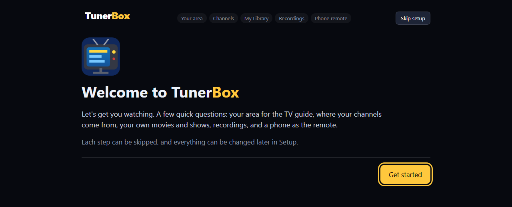

To do it by hand instead, press **Skip setup** and follow this guide. You can run the wizard again any time from **Setup › Overview › Setup wizard**.

With nothing set up yet, the screen says **No channels yet**. Press **Enter** or click it to open **Setup**.

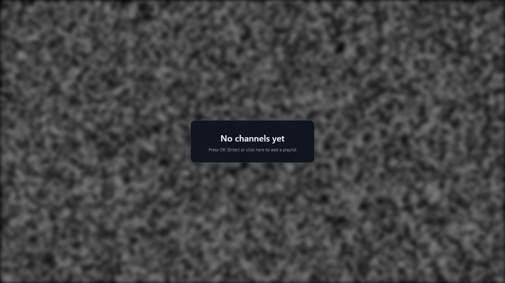

Setup opens on the **Overview**: what's set up so far, and the next step to take.

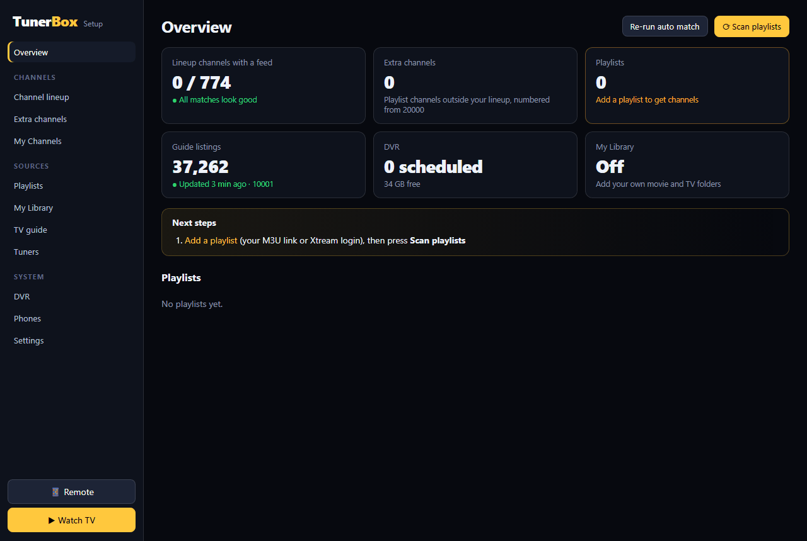

## 2. Pick your TV provider

TunerBox numbers your channels like your cable or satellite box, so 4 is NBC and 3 is TNT where you live. It starts with a sample lineup; to use yours:

1. Open **TV guide**.
2. Enter your ZIP or postal code and press **Find providers**.
3. Pick your provider under **Provider lineup**: your cable company, a satellite service, or *Local Over the Air Broadcast* for an antenna.
4. Press **Save**.

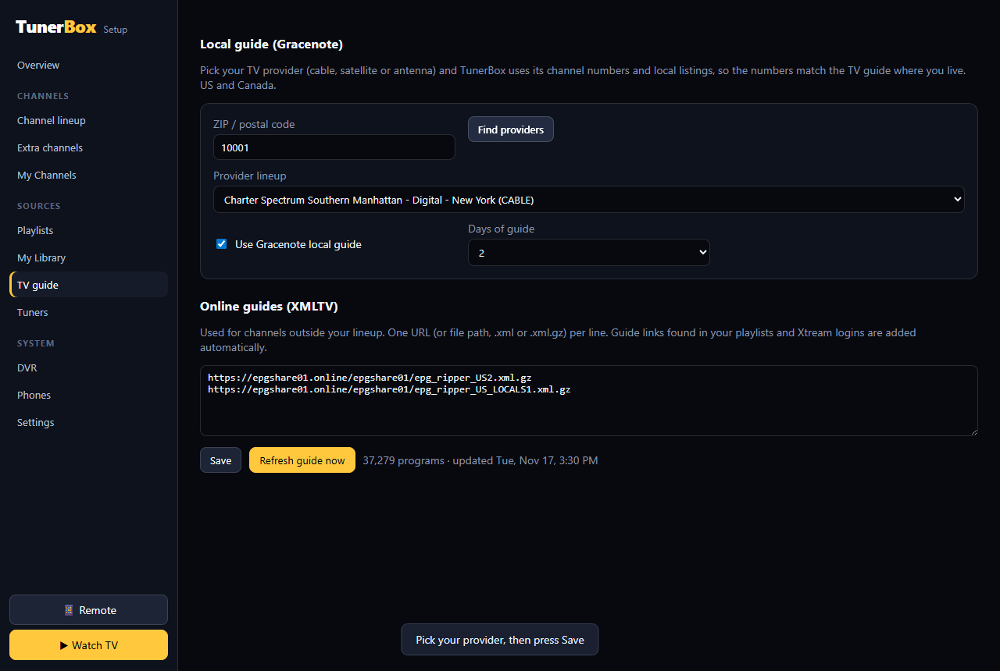

Leave **Use Gracenote local guide** ticked: it gives the guide listings for your provider. The **Online guides (XMLTV)** box is for channels outside your lineup and can stay as it is.

## 3. Add your playlist

Open **Playlists** and press **+ Add playlist**.

* **M3U:** paste the playlist link (or the path to a `.m3u` file). An Xtream `get.php?username=…` link works here too; TunerBox switches it to the Xtream login by itself.
* **Xtream Codes:** set **Type** to *Xtream Codes login* and enter the server address, username and password.
* **HDHomeRun:** set **Type** to *HDHomeRun antenna tuner* and press **Find tuners on my network**, or enter the tuner's address.

Give it a **Name** you'll recognise and press **Add playlist**. The other settings can stay as they are. **Connections** keeps to your provider's limit on streams at once: Xtream logins and HDHomeRun tuners report it themselves.

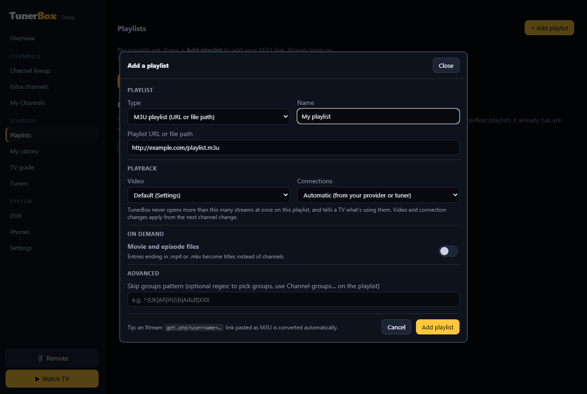

The scan starts straight away; the bar at the top shows how it's going.

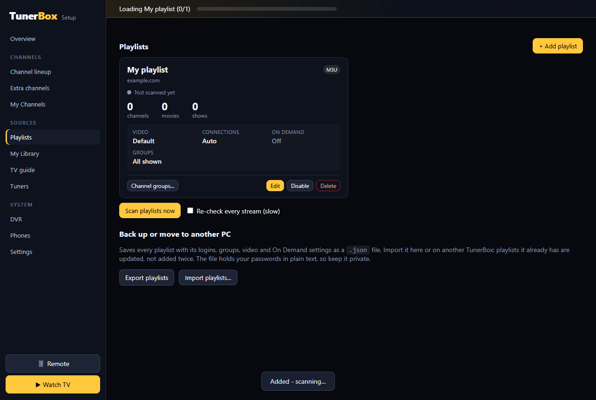

The first scan takes a few minutes. It loads the playlist, checks which streams work, matches channels to your lineup, numbers the rest from 20000 up, and downloads the guide. **Channel groups…** on the card hides groups you don't want, such as other countries or radio.

## 4. Check the channel lineup

When the scan is done, the **Overview** shows how many lineup channels found a feed and what's left to check.

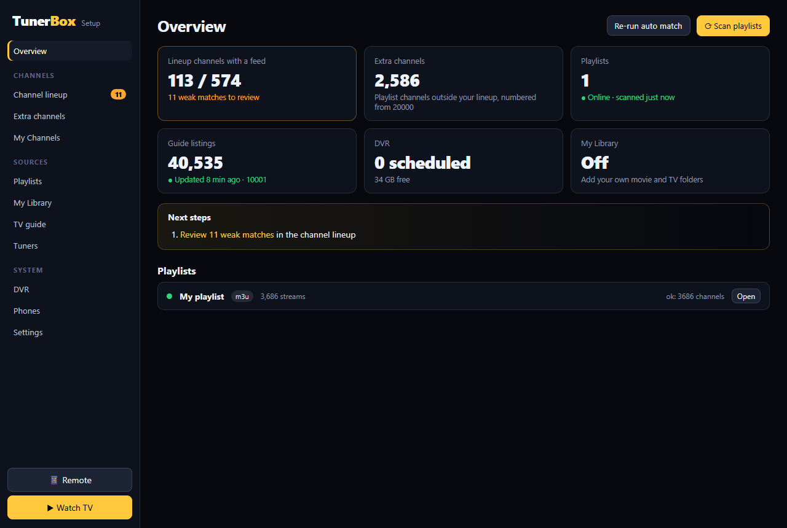

Open **Channel lineup**. Each of your provider's channels is listed with the playlist feed matched to it. A green **AUTO** score is a confident match; **+1**, **+2**… is how many backup feeds it has.

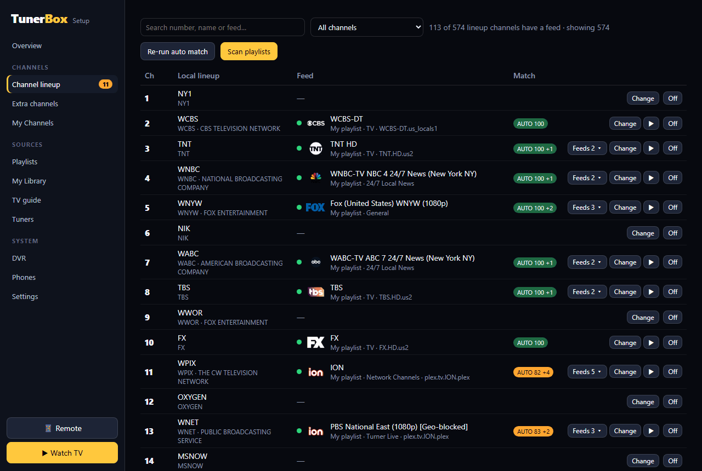

Set the filter to **Weak matches (check these)** to see the guesses worth a look (orange scores). For each one:

* **▶** plays the feed, to see what it is.
* **Change** opens the picker: search every playlist channel, preview with **▶**, and press **Use** to pin the right one. Manual picks are kept on every rescan.
* **Off** leaves a channel you don't want empty.

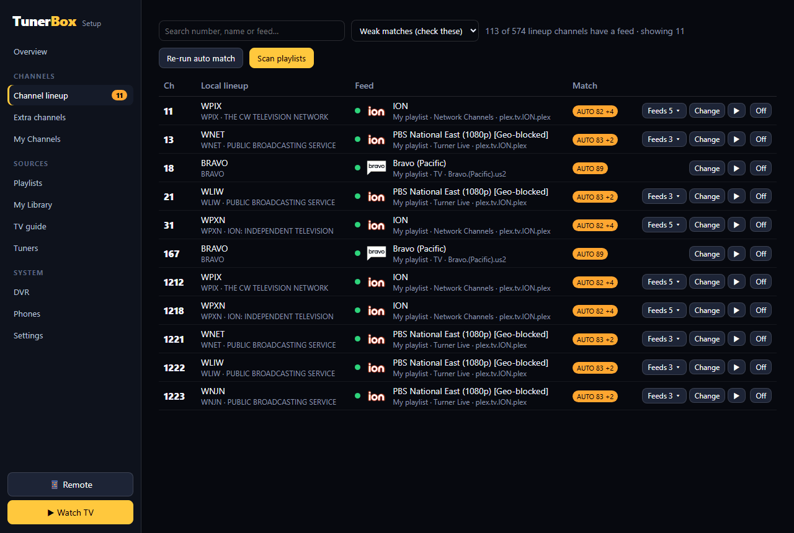

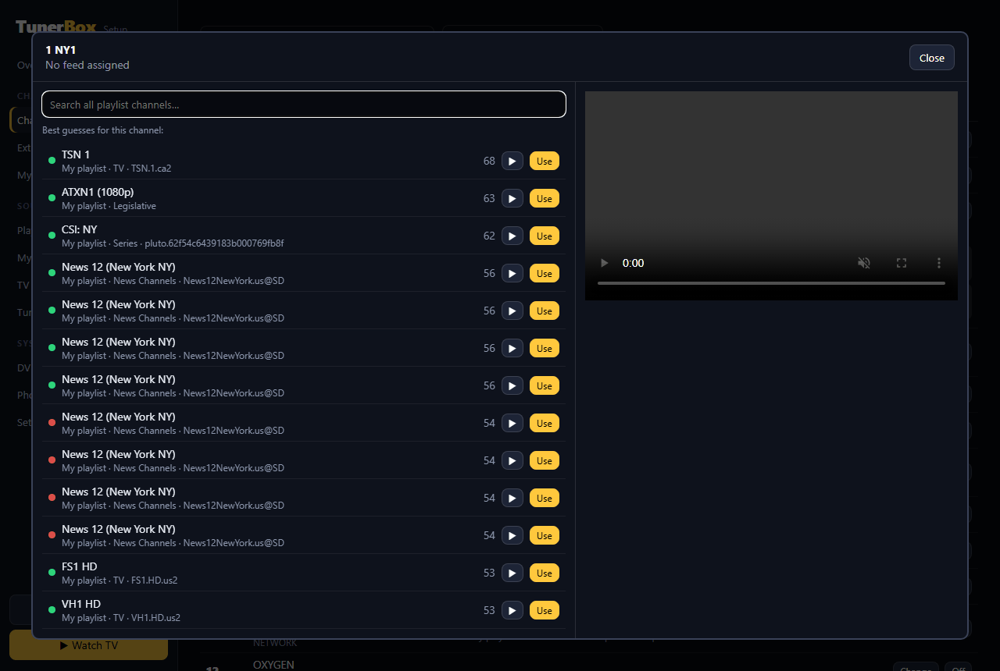

**Feeds** lists a channel's main feed and its backups, in the order they're tried when one fails. **Remove** takes a wrong feed off that channel for good, and **Allow again** brings removed feeds back. **Make main** plays a backup first, and with three or more feeds the ▲ ▼ arrows change the order of the rest; while watching, **Menu › Switch feed** plays another one right away.

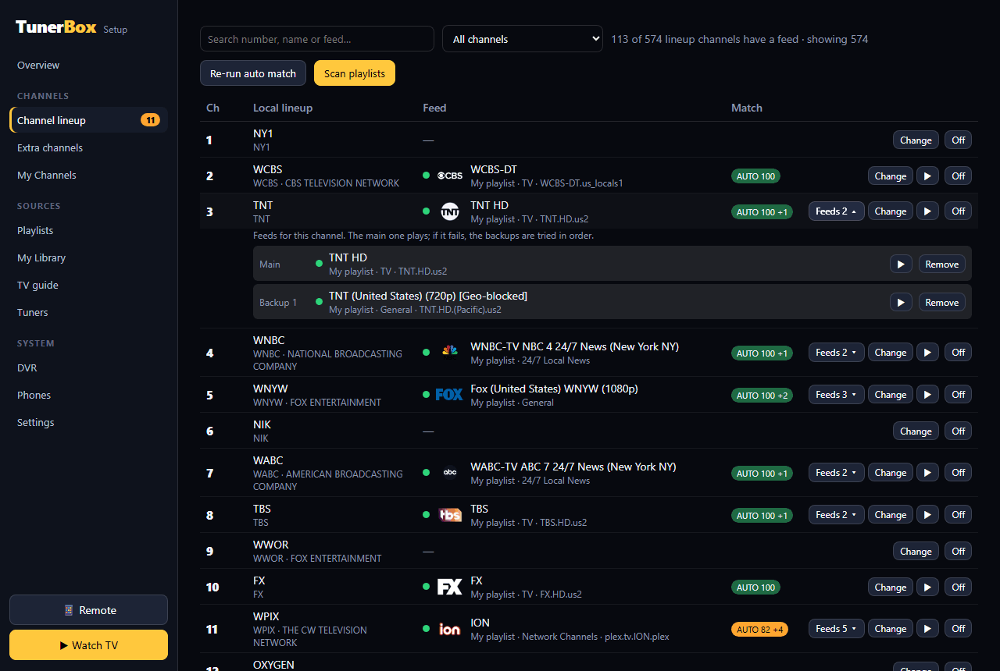

Channels from your playlist that aren't on your provider's lineup (sports events, other countries, streaming channels) are under **Extra channels**, numbered from 20000.

## 5. Watch TV

Press **Watch TV** (bottom left of Setup). TunerBox opens on **Home**: sports on now, your recent and favorite channels, and what's coming up. Press **Esc** (or Back on a remote) for full-screen TV.

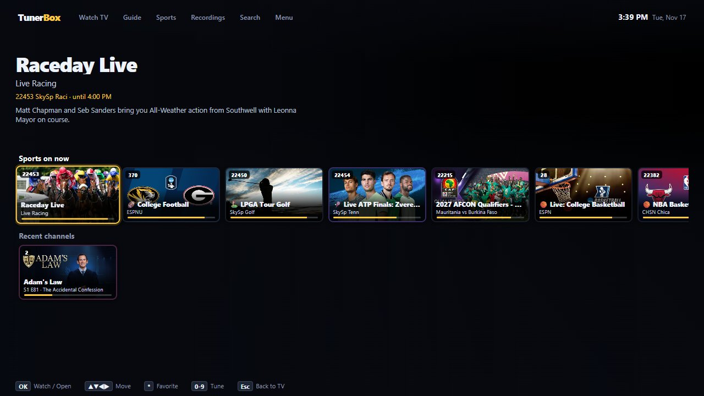

Type a channel number, or use **↑ ↓**, to change channels. The banner shows what's on and what's next; **Enter** brings it back.

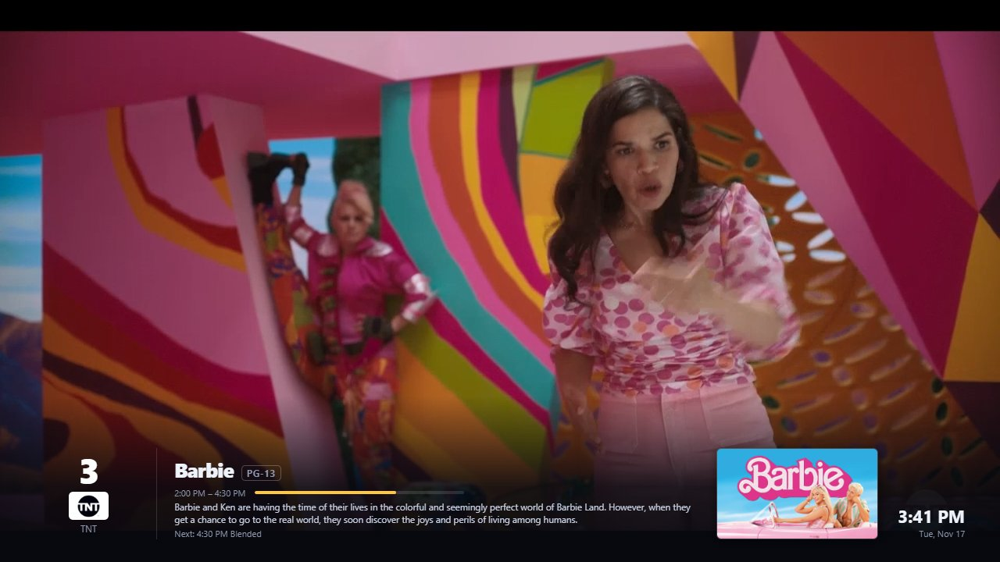

**G** opens the guide, with the picture still playing in the corner. Pick a show to watch it, or press **R** to record it.

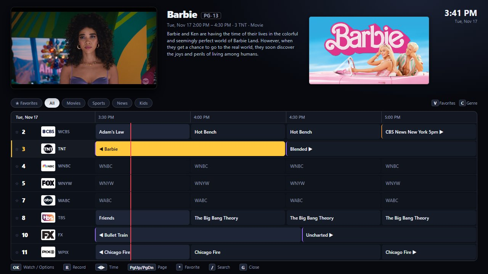

**M** opens the **Menu**: favorites, settings for this screen, sleep timer, themes, remote control setup and more. With a mouse or a touch screen, press **✕ Close** (bottom right) to close it.

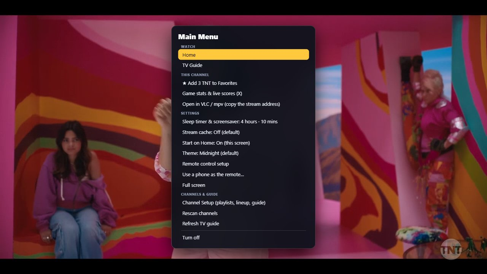

Mouse and touch work too: move the mouse or tap the picture for on-screen buttons. Every key is listed under [Remote / keyboard](../README.md#remote--keyboard).

## 6. Watch on your other screens

TunerBox runs on one computer, which does the tuning, guide and recordings. Other devices on your home network watch from it: open `http://<that-computer>:8642/` in the browser on a TV, tablet or phone.

* **iPad or iPhone:** in Safari, open the address, then Share › **Add to Home Screen**. It opens full screen like an app.
* **Android TV, Fire TV:** open the address in Chrome or Silk.
* **Plex, Emby, Jellyfin, Channels DVR:** add TunerBox as an HDHomeRun at `http://<that-computer>:8642` (see [HDHomeRun](../README.md#hdhomerun-as-a-source-and-as-a-tuner-for-plex)).
* **VLC, TiviMate:** use `http://<that-computer>:8642/playlist.m3u` with the guide at `/epg.xml`.

The computer must be on for the others to watch.

### Use a phone as the remote

In Setup › **Phones**, press **Pair a phone**. Scan the QR code with the phone's camera (or open the address shown on the phone) and enter the 6-digit code. The phone then works as a remote for any TunerBox screen and can manage Setup.

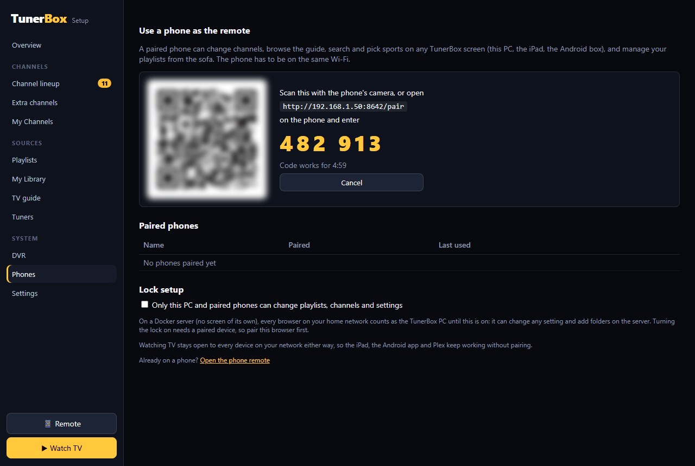

Under **Lock setup**, tick **Only this PC and paired phones can change playlists, channels and settings** so other devices on your network can watch but not change anything.

## 7. See what's using your connections

Xtream logins usually allow only 1 or 2 streams at once. **Tuners** shows each playlist's connections in use against its limit, what each one is playing, and who's watching: a TV screen, a recording, a Roku or an app like Plex. **Stop** ends a stuck or unwanted stream and frees its connection.

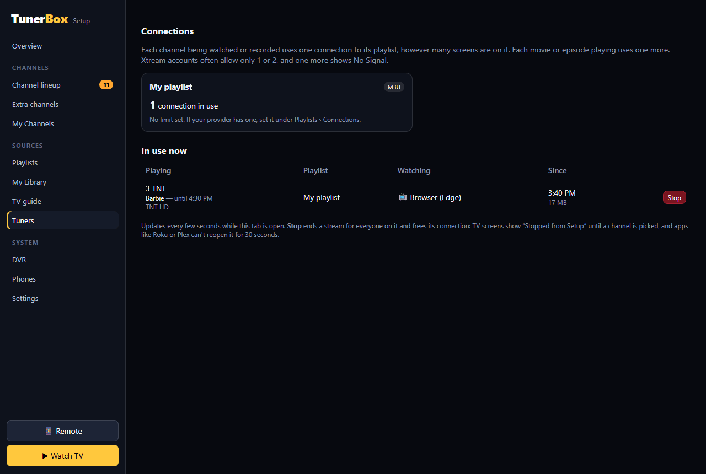

## Next steps

* **Favorites:** press **\*** on a channel; **V** shows a Favorites-only guide.
* **Recordings:** **R** in the guide; **D** lists your recordings. Setup › **Settings › DVR** sets where they're saved. See [Connection limits](../README.md#connection-limits) for how recordings share connections.
* **On Demand:** to add the movies and shows from an Xtream login, press **Edit** on its playlist card and turn them on under **On Demand**. See [On Demand](../README.md#on-demand-movies-and-tv-shows).
* **Your own movies and shows:** Setup › **My Library** adds folders or NAS shares. See [My Library](../README.md#my-library-your-own-movies-and-tv-shows-in-on-demand).
* **Sports:** **T** opens Sports & Events; pick your teams to see their games first. See [Search and Sports & Events](../README.md#search-and-sports--events).

Everything else is in the [README](../README.md).
